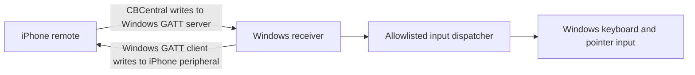

# Design: Windows Bluetooth PC remote

| Revision | Who | Date | What changed |
|---|---|---|---|
| Draft 1 | Codex | 2026-10-28 | Initial design for two-way BLE role support, chosen by the user after reviewing the compatibility trade-off. |

## Options considered

| Option | Benefits | Costs and risks |
|---|---|---|
| Windows is always the BLE peripheral/GATT server | The iPhone scans and selects a PC, matching the current TV picker flow. | Windows peripheral support depends on the Bluetooth adapter and driver; Microsoft's FAQ says not all Windows devices support it. |
| iPhone is always the BLE peripheral/GATT server | Avoids Windows peripheral-role support and lets Windows use its BLE client role. | The Windows receiver must initiate the connection, and the iPhone app must be open and advertising. The PC is not selected from the iPhone's scan list. |
| Support both directions | Retains the iPhone-first discovery flow where the PC supports it and provides a fallback for PCs that do not. | Requires a shared GATT protocol, both role implementations on both sides, two connection entry paths, and device testing for each path. |

The user selected the third option. The Windows receiver checks `BluetoothAdapter.IsPeripheralRoleSupported`: when supported, it advertises a GATT service; otherwise, it scans for the iPhone's service and connects as a GATT client. The iPhone app opens both CoreBluetooth roles while its Windows connection screen is active. If concurrent central/peripheral operation proves unreliable on a device, the UI will expose a manual role switch rather than silently failing.

## Components and flow

Both directions use one custom service UUID and one versioned command protocol. The command characteristic accepts only compact, bounded command frames; a status characteristic reports pairing and connection state. BLE GATT write responses confirm delivery. Text is split into bounded UTF-8 chunks so it fits negotiated GATT write sizes.

### Connection and pairing

1. The person starts the Windows receiver. For fallback, they also open the iPhone app's Windows connection screen and keep the app foregrounded.
2. The Windows receiver uses its GATT server if the adapter supports peripheral mode. Otherwise it scans as a GATT client. In server mode, the iPhone finds the PC in the Bluetooth list; in fallback mode, Windows finds the phone after its iPhone service is advertised.
3. In server mode, Windows displays a short-lived pairing code and the person enters it on the iPhone. In fallback mode, the iPhone displays the code and the person enters it in Windows. Both sides enforce code expiry and an attempt limit.
4. Pairing reads and writes require link encryption. Windows binds the random token to the Bluetooth peer ID and protects the token and ID with DPAPI; the iPhone stores the token in Keychain. Forgetting a Windows-server pairing is done in the Windows receiver; forgetting an iPhone-peripheral pairing is done on the iPhone.
5. The receiver validates protocol version, frame size, sequence, authentication state, and command allowlist before dispatching any input.

## Remote command contract

The UI continues to express semantic actions. The TV transport still maps them to its existing Android key codes and TCP JSON lines. The BLE codec maps them to documented command opcodes; the Windows receiver never receives Android key codes or arbitrary command strings.

| Remote action | Windows behavior |
|---|---|
| Swipe / arrow pad | Move pointer with the touch surface; use arrow keys from the arrow pad |
| Tap / center | Left click / Enter |
| Hold center | Right click |
| Back / Home / Menu | Escape / Windows key / context-menu key |
| Volume / mute / play-pause | Windows media keys |
| Type / delete / enter | Unicode keyboard input / Backspace / Enter |

### Shared GATT contract

- Service UUID: `6D4F0001-4A2B-4B91-A6D7-31B7C2E10510`; command characteristic `6D4F0002-4A2B-4B91-A6D7-31B7C2E10510`; pairing characteristic `6D4F0003-4A2B-4B91-A6D7-31B7C2E10510`; status characteristic `6D4F0004-4A2B-4B91-A6D7-31B7C2E10510`.
- In Windows-server mode, commands use encrypted write-with-response. In iPhone-peripheral mode, the command characteristic sends authenticated notifications to the subscribed Windows client. Pairing and status reads/writes require an encrypted GATT link in both roles.
- Command frames are `version:u8 | opcode:u8 | sequence:u32-le | payload:0..6 bytes | tag:8 bytes`. The tag is the first 8 bytes of HMAC-SHA-256 over all preceding frame bytes, keyed by the 32-byte pairing token. Maximum frame size is 20 bytes to fit the default 23-byte ATT MTU without a long write.
- Sequence numbers must strictly increase for the active connection. Version is `1`; malformed frames, unknown opcodes, invalid payloads, bad tags, and replayed sequences are ignored.
- Opcodes: `0x01` arrow (one direction byte); `0x02` relative pointer move (signed `dx:i16-le`, `dy:i16-le`, each bounded to ±2048); `0x03` left click; `0x04` right click; `0x10` allowlisted key press; `0x11` UTF-8 text chunk (1–6 bytes, split at character boundaries); `0x20` media key. Key and media values are enumerated in `windows/FreeMyTVRemote/Protocol/RemoteProtocol.cs` and its README.
- Pairing writes are `version:u8 | opcode=0x01 | six ASCII digits`. A valid current code creates a 32-byte random token and binds it to `GattReadRequestedEventArgs.Session.DeviceId.Id` / `GattWriteRequestedEventArgs.Session.DeviceId.Id`. DPAPI protects the token and peer ID together. A read returns the token only to that peer during a short retry window; rejected attempts return a two-byte status frame.
- The protected status characteristic is readable and notifiable. Its five-byte value is `version | advertising | paired-peer-subscribed | paired | pairing-status`; a new connection starts a command sequence session. Windows serializes command authentication and input dispatch so accepted sequence order matches Windows input order.
- Pairing codes expire after five minutes. Three bad attempts trigger a one-minute lockout. These bounds limit code guessing while keeping setup recoverable without reopening the app.

The Apps tab and Power button are shown only for TV targets. Windows apps running at a higher integrity level may reject input from a normal receiver; the receiver does not request administrator privileges.

## Wiring

- `ios/FreeMyTVRemote/Model/TVRemote.swift` remains the UI-facing remote facade and preserves the current TV TCP behavior.
- A new CoreBluetooth transport owns central discovery, peripheral advertising, GATT service setup, pairing, connection lifecycle, and BLE frame encoding. `ConnectViews.swift` gains a Windows PC flow while keeping Bonjour/IP TV selection intact.
- `RemoteApp.swift`, `RemoteView.swift`, `Touchpad.swift`, and `AppsView.swift` show the active target, route pointer and keyboard actions, and hide TV app launching for a PC.
- `ios/FreeMyTVRemote/Info.plist` adds the Bluetooth permission explanation; `project.yml` records the same setting for future XcodeGen output. Existing user edits to `Info.plist` and `project.pbxproj` must be preserved.
- A packaged Windows receiver project provides GATT server/client transport, adapter-role detection, pairing UI/storage, and an allowlisted `SendInput` dispatcher. Setup instructions live in the Windows project README. MSIX package identity and the Bluetooth device capability are required for the GATT APIs.
- `app/src/io/freemytv/RemoteServer.java` and the TV protocol are unchanged.

## Security and privacy

- No Wi-Fi or internet service is involved; all control commands stay on the BLE link.
- Require encrypted BLE writes and a one-time user-approved pairing step; persist only a random token in platform-protected stores.
- Bound frame and text sizes, reject unknown opcodes, expire pairing codes, and rate-limit failures.
- Do not support shell execution, file access, screen capture, or remote access outside Bluetooth range.

## Compatibility and deferred scope

- Target Windows 10 version 1703 or later and Windows 11 on x64 or ARM64. The project compiles against the Windows 10 2004 SDK while declaring Windows 10 1703 as its supported minimum; GATT server availability varies by adapter/driver, and fallback uses the Windows GATT client role.
- The iPhone app must remain in the foreground for the initial version. Background operation, remote desktop video, internet relay, and app launching on Windows are out of scope.
- On 2026-10-29, the Windows x64 source compiled and the MSIX packed and signed on Windows 11 with .NET SDK 8.0.427 and Windows SDK 10.0.22621.0. The current package is not installed. The INC3 iPhone source still needs an Xcode build, and neither BLE role direction has been verified on devices.

## Sources

- Apple CoreBluetooth central role: [CBCentralManager](https://developer.apple.com/documentation/corebluetooth/cbcentralmanager).
- Apple CoreBluetooth peripheral role: [CBPeripheralManager](https://developer.apple.com/documentation/corebluetooth/cbperipheralmanager).
- Microsoft GATT server APIs and connectable advertising: [Bluetooth GATT Server](https://learn.microsoft.com/en-us/windows/apps/develop/devices-sensors/gatt-server).
- Microsoft notes peripheral-role support is hardware-dependent and exposes `BluetoothAdapter.IsPeripheralRoleSupported`: [Bluetooth Developer FAQ](https://learn.microsoft.com/en-us/windows/apps/develop/devices-sensors/bluetooth-dev-faq).
- Windows supports GATT client discovery, connection, reads, writes, and notifications: [Bluetooth GATT Client](https://learn.microsoft.com/en-us/windows/apps/develop/devices-sensors/gatt-client).
